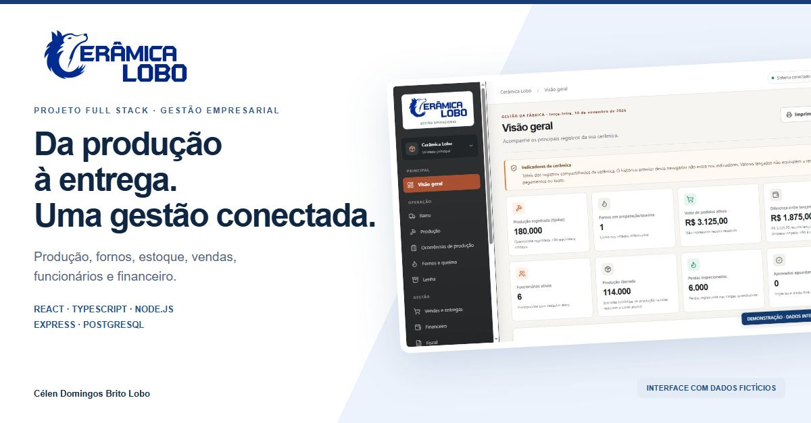
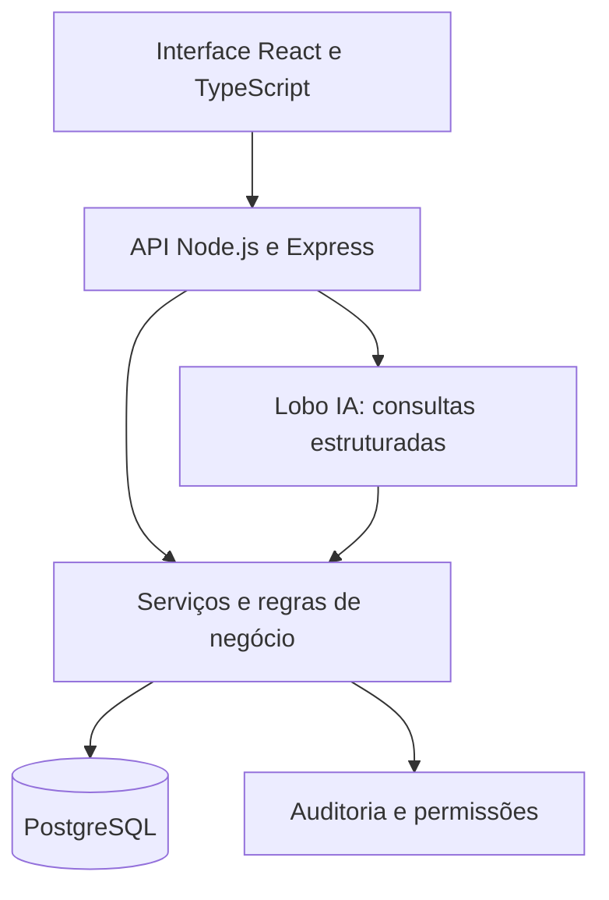
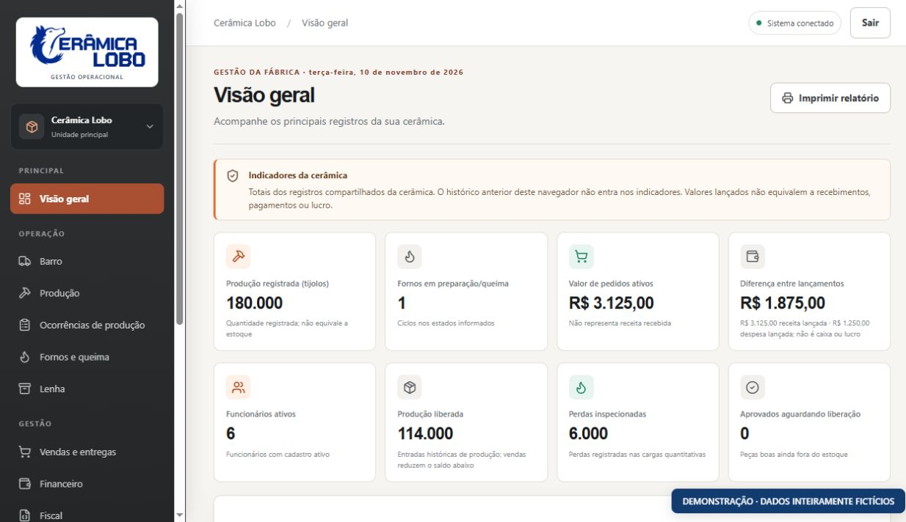
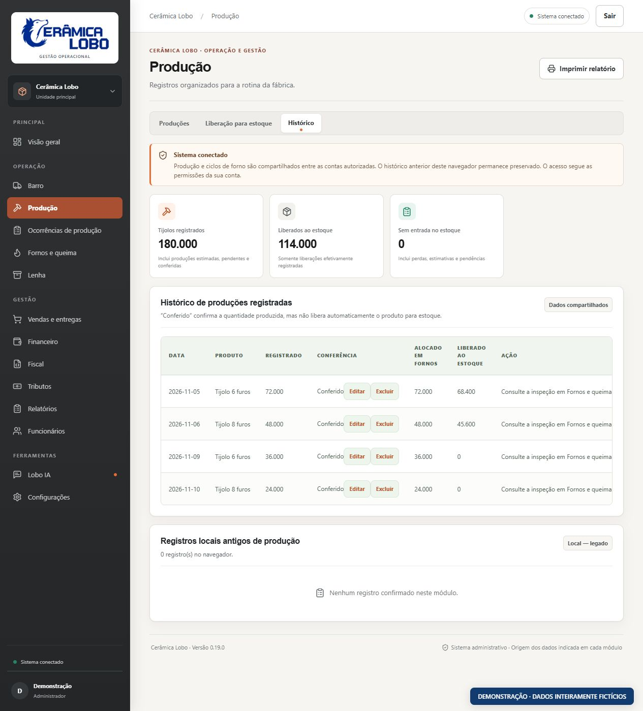
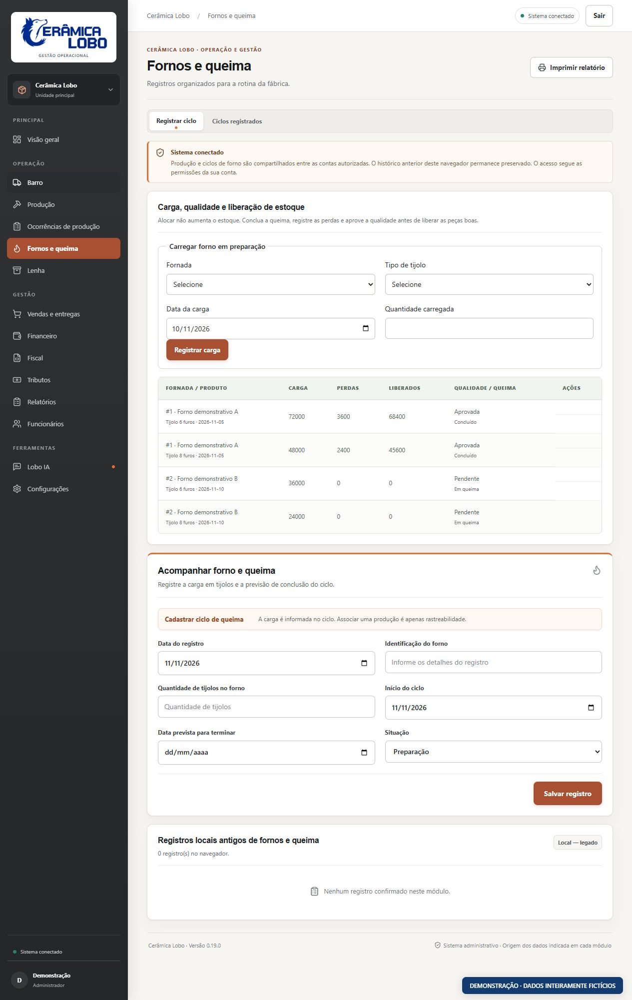
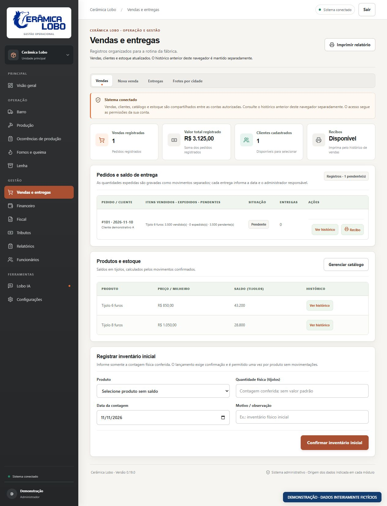
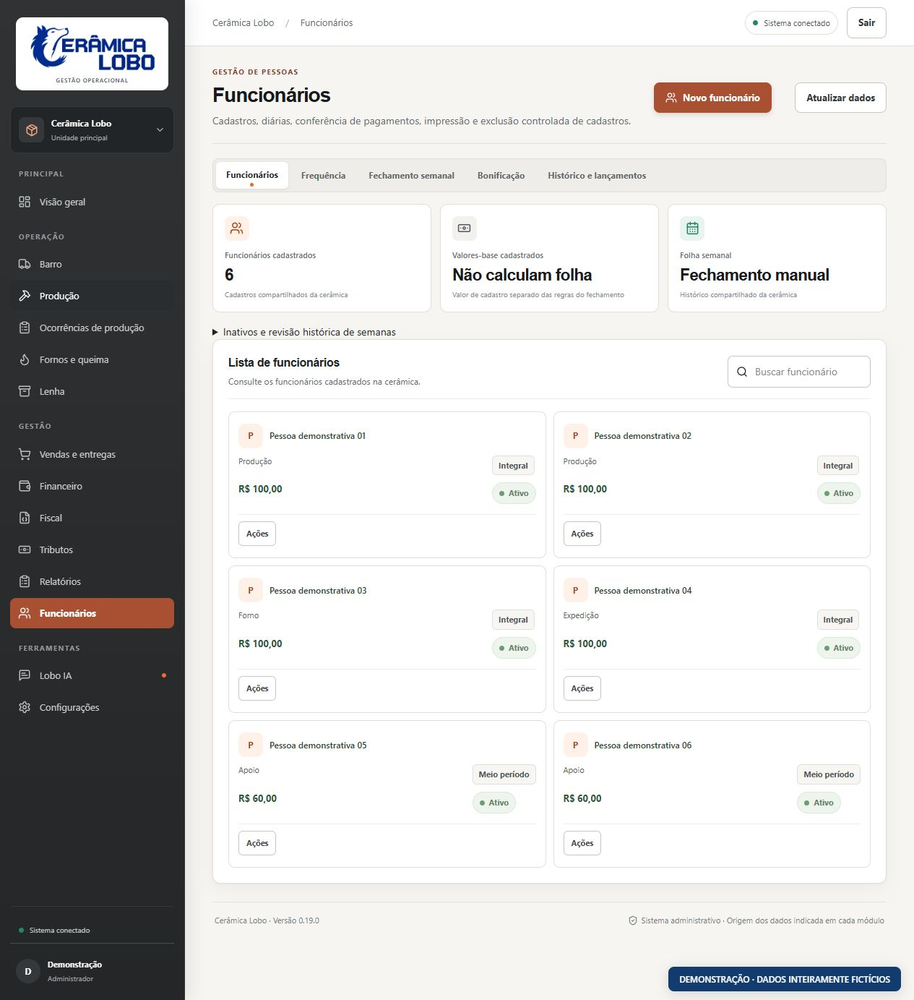
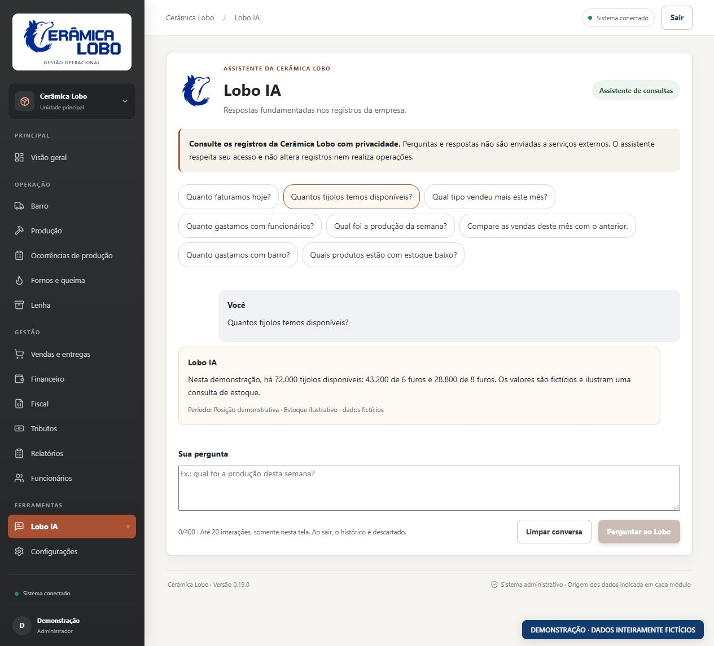

  

# Cerâmica Lobo

**Da produção à entrega: gestão integrada para a rotina de uma cerâmica.**

Um projeto full stack desenvolvido por **Célen Domingos Brito Lobo**, implantado em uma empresa real. Reúne produção, queima, estoque, vendas, funcionários e financeiro em uma aplicação web com acesso por perfil.

Esta é uma vitrine de apresentação. O código-fonte e o ambiente operacional são privados. Todas as telas abaixo utilizam dados inteiramente fictícios; os números apresentados não representam resultados da empresa.

[O projeto](#o-projeto) · [Funcionalidades](#funcionalidades) · [Arquitetura](#arquitetura) · [Galeria](#galeria) · [Contato](#autoria-e-contato)

## O projeto

Uma cerâmica precisa acompanhar etapas que dependem umas das outras: produzir tijolos não significa ter estoque pronto para vender; concluir um pedido não significa receber o pagamento; registrar frequência não significa fechar a semana de trabalho.

A Cerâmica Lobo organiza essas diferenças em fluxos conectados. A produção segue para os fornos, a inspeção registra perdas e a liberação disponibiliza as peças boas. As entregas movimentam o estoque, enquanto o financeiro acompanha títulos e pagamentos separadamente.

O desafio de desenvolvimento foi traduzir regras da operação em uma interface compreensível, mantendo consistência entre os módulos e preservando o histórico.

## Funcionalidades

| Área | O que foi implementado |
| --- | --- |
| Dashboard | Indicadores de produção, estoque, pedidos, funcionários e movimentação financeira, com distinção entre valores lançados e liquidados. |
| Produção | Registros por tipo de tijolo, conferência, histórico e ocorrências de produção. |
| Fornos | Ciclos de vários dias, cargas por produto, perdas, inspeção e liberação das peças aprovadas. |
| Estoque | Saldos por produto, rastreabilidade dos movimentos e prevenção de saídas superiores ao disponível. |
| Vendas | Clientes, pedidos com vários itens, frete, desconto, entregas e recibos comerciais para impressão. |
| Preços | Cadastro por milheiro e conversão automática para preço por unidade na venda, preservando valores históricos. |
| Funcionários | Cadastro, frequência, jornadas, regras de bonificação, fechamento semanal manual, pagamentos e recibos. |
| Financeiro | Contas a pagar e a receber, parcelas, baixas parciais ou integrais, categorias e relatórios. |
| Insumos | Viagens e custos de barro; compras e consumo de lenha em metros cúbicos. |
| Acessos | Perfis de usuário, gerenciamento administrativo de contas e auditoria de alterações. |

**Exemplo de cálculo:** R$ 850,00 por milheiro corresponde a R$ 0,85 por tijolo. Um pedido com 3.500 tijolos tem subtotal de R$ 2.975,00; frete e desconto são calculados separadamente. O exemplo é ilustrativo.

### Estrutura fiscal: limites atuais

O projeto inclui cadastros fiscais, documentos em rascunho, registros de tributos e uma arquitetura de integração com emissor. A emissão oficial de NF-e depende de configuração tributária validada pelo contador, credenciais, credenciamento e homologação externa. Recibos comerciais não são notas fiscais. Esta apresentação não demonstra emissão fiscal real.

## Tecnologias

| Camada | Tecnologias |
| --- | --- |
| Interface | React, TypeScript, Vite, CSS e Lucide React |
| Backend | Node.js, Express e TypeScript |
| Persistência | PostgreSQL, transações e migrations SQL incrementais |
| Aplicativo web | Web App Manifest e Service Worker |
| Qualidade | Testes automatizados de backend, interface/PWA e scripts; integração em PostgreSQL descartável |

## Arquitetura

As regras e autorizações são verificadas no backend. Operações relacionadas usam transações para manter a consistência. O histórico dos lançamentos é preservado, e mudanças de estrutura são controladas por migrations.

## Segurança e permissões

O sistema possui perfis de Administrador, Operador e Proprietário, com escopos distintos. As restrições de acesso também são aplicadas no servidor. Senhas são armazenadas com hash, operações sensíveis possuem auditoria e entradas são validadas.

A apresentação pública não contém credenciais, dados de clientes ou funcionários, cópias do banco, código privado ou configurações de hospedagem. Segurança é uma atividade contínua; esses mecanismos não representam garantia de ausência de vulnerabilidades.

## Lobo IA

Um assistente de consultas em português para perguntas como “quantos tijolos temos disponíveis?” ou “qual foi a produção da semana?”.

A versão apresentada usa **identificação determinística de intenções e consultas estruturadas**. Não é um modelo generativo e não executa SQL livre produzido por IA. As consultas respeitam as permissões de cada perfil, informam o período e a origem dos dados e não alteram registros. Perguntas fora do escopo recebem uma resposta de limitação.

Nesse modo, perguntas e respostas não são enviadas a serviços externos. O histórico da conversa é temporário na tela.

## PWA

A aplicação conta com manifesto, ícones oficiais, modo independente e orientações de instalação. A instalação depende dos recursos do navegador e do sistema operacional; a presença desses componentes não substitui testes reais em cada dispositivo.

O Service Worker adota navegação pela rede. Não mantém cache operacional de API, autenticação ou respostas do assistente e não oferece gravações offline. Quando a conexão cai, a interface informa a indisponibilidade para evitar lançamentos inconsistentes.

## Qualidade e validação

A validação da versão apresentada registrou **169 testes automatizados aprovados**:

- 139 testes de backend, incluindo integração com PostgreSQL local descartável.
- 19 testes de interface, textos, configuração de publicação e PWA.
- 11 testes de scripts e empacotamento.

Os cenários incluem autenticação e permissões, ciclo de produção/queima/estoque/venda, fechamento de funcionários, cálculos monetários e preservação de dados históricos. Os builds de frontend e backend também foram aprovados.

Esses resultados pertencem à validação desta versão. As imagens da vitrine ilustram a interface e não constituem evidência de resultados operacionais ou de homologação fiscal.

## Galeria

Capturas da interface da versão apresentada, executada localmente com respostas de demonstração. Nenhum banco real foi copiado. Pessoas, clientes, pedidos, quantidades e valores são fictícios. A resposta do assistente exibida nesta galeria também é demonstrativa.

### Dashboard

Indicadores com distinção entre produção, estoque, pedidos e valores financeiros.

### Produção

Conferência das quantidades e acompanhamento das etapas posteriores.

### Fornos

Cargas, perdas, qualidade e liberação de estoque no mesmo fluxo.

### Vendas

Pedidos, saldo de entrega e catálogo com preços por milheiro.

### Funcionários

Organização dos cadastros, jornadas e acesso às etapas do fechamento semanal.

### Lobo IA

Uma pergunta de estoque respondida com período e origem identificados.

## Status

Sistema implantado para acesso restrito da empresa. Esta vitrine representa a versão `3763402` e não disponibiliza o ambiente operacional, o código-fonte ou credenciais para demonstração pública.

Os próximos passos fiscais dependem de validação contábil e homologação externa. A instalação da PWA deve ser verificada nos dispositivos de destino.

## Autoria e contato

**Célen Domingos Brito Lobo** · Desenvolvimento full stack

[GitHub](https://github.com/celenlobo) · [LinkedIn](https://www.linkedin.com/in/c%C3%A9len-l%C3%B4bo-11bb14422/)

Código-fonte privado. A disponibilização desta apresentação não concede licença sobre o software ou a marca.
